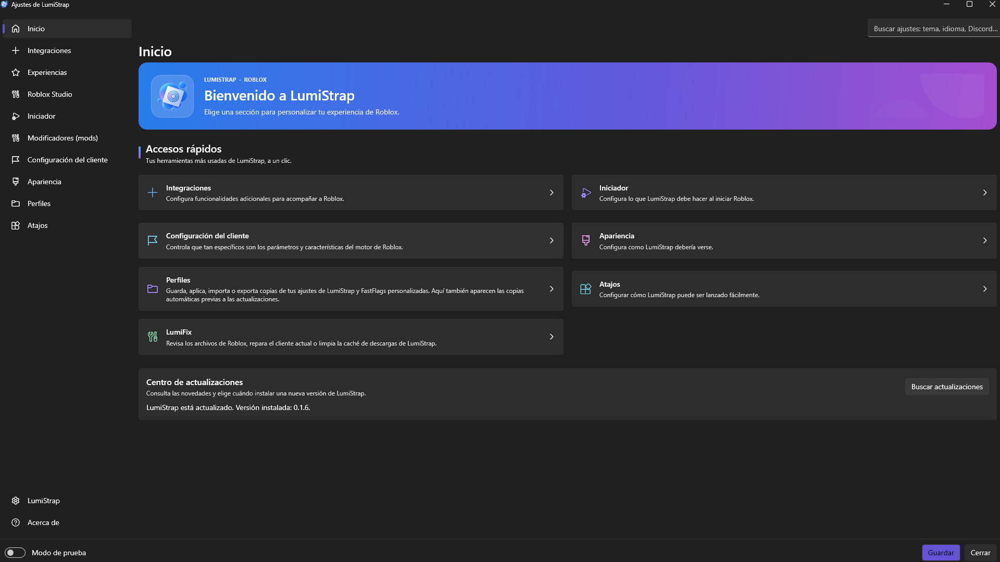

<div align="center">
  
  <p><strong>Roblox setup and customization, with more clarity and control.</strong></p>
  <p>
    <a href="https://github.com/gggds2/LumiStrap/releases/latest"></a>
    <a href="https://github.com/gggds2/LumiStrap/releases"></a>
    <a href="LICENSE"></a>
  </p>
  <p>
    <a href="https://gggds2.github.io/LumiStrap/"><strong>Explore the website</strong></a>
    · <a href="https://github.com/gggds2/LumiStrap/releases/latest">Download</a>
    · <a href="https://github.com/gggds2/LumiStrap/issues">Get help</a>
  </p>
</div>

<p align="center">
  <a href="https://gggds2.github.io/LumiStrap/#recorrido">
    
  </a>
</p>

LumiStrap is an independent community fork of [Bloxstrap](https://github.com/bloxstraplabs/bloxstrap) for Windows. It brings together Roblox setup, client preferences, profiles, and repair tools in one place.

**Version 0.1.6** adds the Update Center, shareable Lumi themes, Performance, Balanced, and Quality graphics profiles, and a hardware-aware graphics assistant. It also includes the Roblox Studio, Experiences, Discord privacy, LumiFix, and profile history features introduced in 0.1.5.

> LumiStrap is not affiliated with or endorsed by Roblox Corporation.

**On this page:** [Features](#features) · [Install](#install) · [FAQ](#faq) · [Privacy](#privacy-and-compatibility) · [Build](#build-from-source) · [License](#credits-and-license)

## Features

| Tool | What it helps with |
| --- | --- |
| **Graphics profiles** | Choose Performance, Balanced, or Quality, then customize client settings. Manual changes appear as Custom. |
| **Graphics assistant** | Detect CPU, memory, and graphics hardware locally; preview a Performance, Balanced, or Quality recommendation before applying it. |
| **Lumi Themes** | Choose built-in palettes, switch between light and dark, customize colors, and import or export `.lumitheme` files. |
| **Roblox Studio and FastFlags** | Manage Studio settings, global options, and FastFlags. Roblox decides which flags are allowed and may change their behavior. |
| **Experiences** | Add places by Roblox link or place ID, keep favorites, and browse recent games. Recent games can be added automatically with activity tracking enabled. |
| **LumiFix** | Check processes and Roblox files before launch, inspect the installation, repair client files, or clear the download cache. The pre-launch check does not close programs or edit files. |
| **Profiles and history** | Save, apply, import, and export settings. LumiStrap keeps up to 20 recent configuration backups that you can restore. Profiles contain configuration only. |
| **Session panel** | See available experience and server information, with quick access to LumiStrap tools while playing. |
| **Discord privacy** | Temporarily hide Roblox activity and join buttons, then restore your previous options when privacy mode is turned off. |
| **Downloads and errors** | Follow download progress and speed, retry or cancel, and get clearer explanations of common problems. |
| **Update Center** | Check for a new LumiStrap release, review its changes, and choose when to install it. |

The [LumiStrap website](https://gggds2.github.io/LumiStrap/) has a step-by-step tour and the latest release notes.

## Install

1. Open [the latest release](https://github.com/gggds2/LumiStrap/releases/latest).
2. Download the single file, `LumiStrap.exe`.
3. Run it to start the LumiStrap installer.

## FAQ

<details>
  <summary>Does LumiStrap include Roblox or game modifications?</summary>
  <p>No. LumiStrap installs and manages the Roblox client. Profiles save configuration only; they do not contain Roblox files or mods.</p>
</details>

<details>
  <summary>Will every FastFlag work?</summary>
  <p>No. Roblox decides which FastFlags are permitted and can change their availability or behavior in future updates.</p>
</details>

<details>
  <summary>What does LumiFix change?</summary>
  <p>You choose whether to inspect the installation, repair Roblox client files, or clear LumiStrap's download cache. LumiStrap explains the selected action before it proceeds.</p>
</details>

<details>
  <summary>Is LumiStrap separate from Bloxstrap?</summary>
  <p>Yes. LumiStrap uses its own installation folder and settings.</p>
</details>

## Privacy and compatibility

- LumiStrap is for Windows.
- Analytics are disabled by default.
- Roblox controls which FastFlags are accepted and how they behave.

## Build from source

Use Windows and the .NET SDK version listed in `global.json`. Initialize the `wpfui` submodule, then restore and build the solution:

```powershell
git submodule update --init --recursive
dotnet restore
dotnet build -c Release
```

## Credits and license

LumiStrap is derived from the open-source [Bloxstrap](https://github.com/bloxstraplabs/bloxstrap) project and retains its MIT license and upstream copyright notice in [`LICENSE`](LICENSE). Keep that file with any redistribution.
