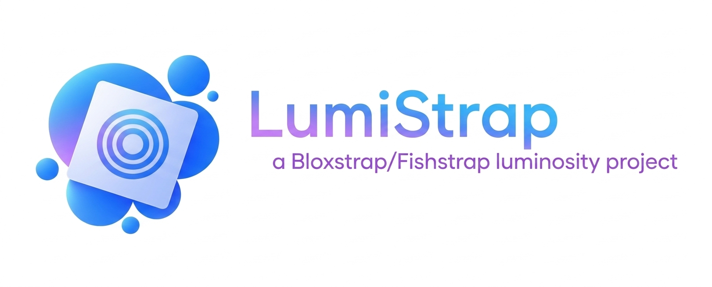
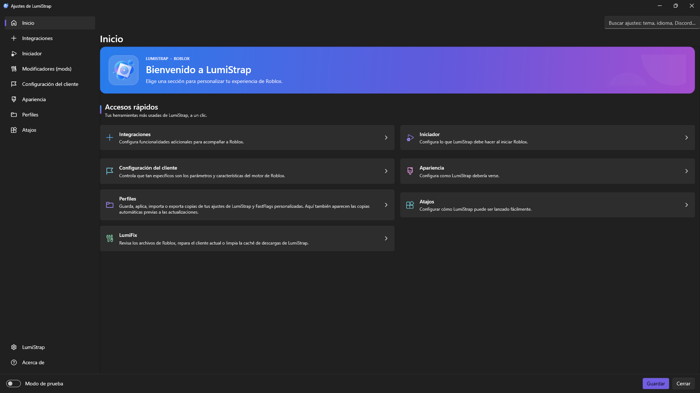

<div align="center">
  
  <p><strong>A clearer way to install and customize Roblox on Windows.</strong></p>
  <p>
    <a href="https://github.com/gggds2/LumiStrap/releases/latest"></a>
    <a href="https://github.com/gggds2/LumiStrap/releases"></a>
    <a href="LICENSE"></a>
  </p>
  <p>
    <a href="https://gggds2.github.io/LumiStrap/"><strong>Visit the LumiStrap website</strong></a>
    · <a href="https://github.com/gggds2/LumiStrap/releases/latest">Download</a>
    · <a href="https://github.com/gggds2/LumiStrap/issues">Get help</a>
  </p>
</div>

<p align="center">
  <a href="https://gggds2.github.io/LumiStrap/#capturas">
    
  </a>
</p>

LumiStrap is an independent community fork of [Bloxstrap](https://github.com/bloxstraplabs/bloxstrap), made to give Roblox players on Windows useful tools and a clear way to manage their setup and preferences.

> LumiStrap is not affiliated with or endorsed by Roblox Corporation.

## Features

| Feature | What it does |
| --- | --- |
| **LumiFix** | Reviews the Roblox installation, repairs client files, or clears the download cache after explaining the action. |
| **Profiles** | Saves and switches between LumiStrap settings and custom FastFlags. Profiles store configuration only. |
| **Session information** | Shows available experience and server details, with quick access to LumiStrap tools while playing. |
| **Graphics and FastFlags** | Offers rendering, mesh detail, texture, and other client settings. Roblox may limit or ignore some FastFlags. |
| **Clearer downloads and errors** | Shows download progress and speed, supports retry and cancel, and helps explain errors in plain language. |
| **Safer updates** | Previews version changes and creates a configuration backup before updating. |

See the [website gallery](https://gggds2.github.io/LumiStrap/#capturas) for screenshots of the main sections.

## Install

1. Open the [latest release](https://github.com/gggds2/LumiStrap/releases/latest).
2. Download the single file, `LumiStrap.exe`.
3. Run it to start the LumiStrap installer.

## Privacy and compatibility

- LumiStrap is for Windows.
- Analytics are disabled by default.
- LumiStrap uses an installation folder separate from Bloxstrap.
- Roblox controls which FastFlags are accepted and how they behave.

## Build from source

Use Windows and the .NET SDK version listed in `global.json`. Initialize the `wpfui` submodule, then restore and build the solution:

```powershell
git submodule update --init --recursive
dotnet restore
dotnet build -c Release
```

## Credits and license

LumiStrap is derived from the open-source [Bloxstrap](https://github.com/bloxstraplabs/bloxstrap) project and retains its MIT license and upstream copyright notice in [`LICENSE`](LICENSE). Keep that file with any redistribution.
